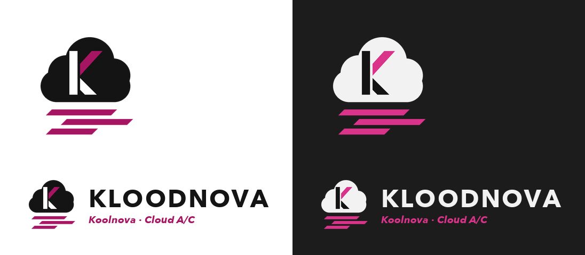

<p align="center"></p>

# Kloodnova — Koolnova × Home Assistant

Intégration Home Assistant pour un système de climatisation par zones Koolnova,
via leur cloud (`api.koolnova.com`). Le domaine de l'intégration est `kloodnova` ;
le compte à utiliser est votre compte **Koolnova** (celui de l'app).

**État** : intégration fonctionnelle, testée contre le vrai cloud (lecture et
écriture du client) et par 40 tests automatisés. À valider dans votre Home Assistant.

## Installation dans Home Assistant

### Avec HACS (recommandé)

1. *HACS → ⋮ (menu) → Dépôts personnalisés*, ajouter
   `https://github.com/benbox69/ha-kloodnova` avec la catégorie **Intégration**.
2. Installer « Kloodnova » depuis HACS, puis **redémarrer** Home Assistant.
3. Les mises à jour suivantes se font depuis HACS.

### À la main

1. Copier le dossier `custom_components/kloodnova/` dans le dossier
   `config/custom_components/` de votre Home Assistant, puis redémarrer.
2. *Paramètres → Appareils et services → Ajouter une intégration → Kloodnova*.
3. L'assistant demande, dans l'ordre :
   1. **vos identifiants** Koolnova (ceux de l'app) ;
   2. **les projets** (installations) à ajouter ;
   3. **les zones** à ajouter.
4. Pour changer plus tard : *Kloodnova → Configurer*, qui propose un menu :
   - **Projets et zones** : les zones décochées sont supprimées de HA ;
   - **Intervalle de rafraîchissement** (15 à 600 s, 60 s par défaut), appliqué
     immédiatement, sans rechargement.

## Mettre à jour une version déjà installée

1. Remplacer le dossier `config/custom_components/kloodnova/` par la nouvelle version
   (copie directe sur le partage `config` de Home Assistant, ou Samba/SSH/File editor).
2. **Redémarrer Home Assistant** : *Paramètres → Système → Redémarrer*. Un simple
   « Recharger » de l'intégration ne suffit pas, car le code Python déjà chargé n'est pas relu.
3. Vérifier *Paramètres → Système → Journaux* (filtrer « kloodnova ») : aucune erreur attendue.
4. Les entités existantes sont conservées (identifiants inchangés) ; la configuration
   (identifiants, projets, zones) n'a pas besoin d'être refaite.

Version minimale de Home Assistant testée : **2025.1**.

## Ce qui est créé : un appareil par projet

Chaque projet devient **un seul appareil « Kloodnova <Projet> »** qui regroupe les
thermostats de ses zones et les réglages de la centrale. Tous les identifiants
suivent le modèle `kloodnova_<projet>_…` :

| Entité | Section de l'appareil | Rôle |
|---|---|---|
| `climate.kloodnova_<projet>_<zone>` (une par zone choisie) | Contrôles | température mesurée / consigne (pas 0,5 °C), `off` / `heat` / `cool`, **ventilation** |
| `select.kloodnova_<projet>_mode` | **Configuration** | **mode global** de la centrale : climatisation, chauffage (plancher si activé sur l'installation) |
| `select.kloodnova_<projet>_fan` | **Configuration** | **ventilation globale** : faible, moyenne, forte, auto |
| `switch.kloodnova_<projet>_general_stop` | **Configuration** | **arrêt général** de la climatisation (activé = centrale à l'arrêt, comme le bouton STOP de l'app) |
| `binary_sensor.kloodnova_<projet>_connected` | Diagnostic | la centrale est-elle en ligne ? |
| `sensor.kloodnova_<projet>_wi_fi_signal` | Diagnostic | RSSI (désactivé par défaut) |

Exemple pour le projet « Maison » : `climate.kloodnova_maison_office`,
`select.kloodnova_maison_mode`, `switch.kloodnova_maison_general_stop`.

### À savoir

- **Le mode chaud/froid est global.** Demander `heat` ou `cool` sur un thermostat
  change le mode de la centrale, donc de toutes les zones.
- **La ventilation est globale** (vérifié : régler une zone règle toutes les zones).
  Elle reste réglable depuis chaque thermostat **et** depuis l'appareil du projet ;
  dans les deux cas, toutes les zones suivent.
- **Arrêt général** : tant qu'il est activé, tous les thermostats apparaissent `off`.
  À la reprise, la centrale remet la ventilation sur `auto` environ 6 s plus tard.
- **Hors ligne** : si la centrale est déconnectée du cloud, les thermostats et
  les réglages passent en `indisponible`.
- **Rafraîchissement** : toutes les 60 s par défaut, réglable de 15 à 600 s (une seule requête par projet). Après
  une commande, l'état affiché est immédiat puis confirmé par une relecture 5 s plus tard.
- **Plage de consigne** 15–30 °C : choix par défaut, non vérifié (à confirmer).
- **Mise à jour depuis une version antérieure** : les thermostats sont rattachés à
  l'appareil du projet et les anciens appareils de zone sont supprimés. Les
  identifiants **générés automatiquement** par les versions précédentes
  (`climate.office`, `select.maison_mode`…) sont renommés en `kloodnova_<projet>_…` (y compris ceux de la version intermédiaire en `koolnova_<projet>_…`)
  (pensez aux tableaux de bord et automatisations qui les citent). Un identifiant que
  vous avez personnalisé n'est jamais renommé, ni un identifiant déjà pris par une autre entité.

## Contenu du dépôt

| Chemin | Rôle |
|---|---|
| `custom_components/kloodnova/` | l'intégration (`api.py` = client, sans dépendance à HA) |
| `custom_components/kloodnova/brand/` | logo et icône (clair et sombre) affichés par HA |
| `assets/` | sources du logo : `build_brand.py` (génère SVG et PNG), SVG, aperçu |
| `koolnova_api.py` | lien symbolique vers `api.py`, pour les scripts et le test en ligne de commande |
| `test_koolnova_api.py` | test du client contre le vrai cloud (CLI) |
| `tests/` | tests de l'intégration (pytest) |
| `docs/API.md` | documentation de l'API : routes, formats, pièges. **À lire en premier.** |

## Non officiel

Kloodnova est un projet **indépendant, non affilié à Koolnova** et non approuvé par
cette société. Il s'appuie sur l'API cloud de Koolnova telle qu'elle est observée dans
ses applications officielles : elle n'est pas documentée publiquement et peut changer
sans préavis. « Koolnova » est une marque de ses propriétaires ; le nom « Kloodnova » et
le logo de ce dépôt sont des créations originales qui n'impliquent aucun lien officiel.
À utiliser à vos risques, avec votre propre compte.

## Logo

Un nuage (le cloud) portant un **K** à facettes dans l'esprit de Koolnova, noir et
magenta, avec trois filets d'air de climatisation dessous. Régénération :
`.venv/bin/pip install pillow && .venv/bin/python assets/build_brand.py`.
Home Assistant charge les images du dossier `brand/` des intégrations
personnalisées dans les versions récentes (2026.3 et plus, à vérifier).

## Tests

```bash
# 1) Client contre le vrai cloud (lecture seule ; --write = écritures réversibles)
python3 -m venv .venv && .venv/bin/pip install -r requirements.txt
export KOOLNOVA_EMAIL=… KOOLNOVA_PASSWORD=…          # sinon demandés au clavier
.venv/bin/python test_koolnova_api.py [--write [--with-stop]]

# 2) Intégration avec un vrai Home Assistant et un faux client (40 tests, sans réseau)
/opt/homebrew/bin/python3.12 -m venv .venv-ha
.venv-ha/bin/pip install -r requirements-test.txt
.venv-ha/bin/python -m pytest

# 3) Intégration de bout en bout contre le vrai cloud (lecture seule)
KOOLNOVA_EMAIL=… KOOLNOVA_PASSWORD=… .venv-ha/bin/python -m pytest tests/test_live.py
```

## À faire

- [ ] Valider dans votre Home Assistant (2026.10) : affichage, logo, migration.
- [ ] Confirmer la plage de consigne acceptée par les centrales.
- [ ] Vérifier les modes plancher 4/5/6 si une installation les active.
- [x] WebSocket : étudié, **inutilisable** (routes non servies ; l'app web fait elle-même du polling toutes les 50 s). Voir `docs/API.md`.

## Sécurité

Ne jamais committer d'identifiants ni de tokens (voir `.gitignore`). Le mot de
passe est stocké dans l'entrée de configuration de HA, car l'API n'offre pas
d'autre moyen de se reconnecter quand les tokens (500 jours) expirent.

## Licence

[MIT](LICENSE)
